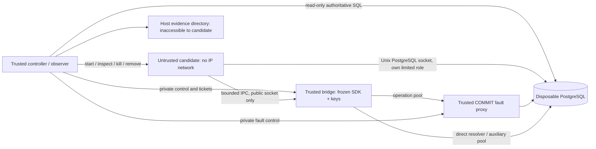

# OrderTruth V3 — W2 verifier hardening implementation plan

Date: 2026-11-03 IST. Revision 4 (owner-requested reduced resource profile). Baseline: Revision 3 committed at `d55a1a576842cab06f4550edd7b007791db2bcfc`, following Claude PASS; product baseline `fixes@8300b3ff305d9a71a4dd562b97b0eef6b01708e2`.
Status: **AMENDMENT AWAITING CLAUDE REVIEW.** W2 CP0 Revision 3 is complete. CP1 execution is already authorized, but remains on HOLD until this reduced-profile amendment receives PASS and a fresh capacity recheck passes. Preserve owner-controlled planning commits; do not treat Revision 3's PASS as approval of these changed limits. W4 planning is separately authorized; W4 implementation remains unauthorized. No product, historical manifest, W1 artifact or existing judge change is authorized by this amendment.

## 1. Outcome, constraints and evidence status

Make the existing fixed P1/T1 lab verifier capable of evaluating bounded untrusted merchant integration code without letting that code authenticate its own guard records, hide effects, alter expected outcomes, retain work between scopes or reach private resources. This is local verifier hardening, not a production malware sandbox or Gate B.

One builder; independent Claude review and owner commit at each checkpoint. No agent Git writes. ₹0 external spend. No model/PayPal calls, deployment, CI service, new dependencies, credential files or holdout access. W3 execution remains unauthorized even after W2 passes. Future candidate code runs only inside the approved disposable boundary, never in host imports, build hooks or test discovery.

VERIFIED by source inspection: candidate environment currently includes the two signing keys; roles.sql permits candidate INSERT/UPDATE on guard/shop records; `candidate` inherits the full qualify image; one long-lived candidate container is used; timeout kills the Docker CLI; fresh clones become connectable before database ACL repair; report.ts pins old NC predicates and manifest.ts enumerates offline tests individually. L21 currently targets OPERATION and ISSUANCE, not REJECTION_AUDIT. `orderFacts` incorporates candidate-reported claim codes.

RECORDED_NOT_REPRODUCED in planning: Gate A CP4, W1's 1152 host / 282 Node22 tests and browser QA. W1 is closed after Claude source PASS and owner commit. No new runtime/security test is claimed here. Proposed socket, ACL and containment behavior below is NOT_TESTED until the specified checkpoint.

## 2. Threat model and protected assets

The adversary controls the merchant handler source and all code it can execute in its candidate container: globals, imports, subprocesses, stdout/stderr, SQL under its disposable role, API requests and time consumption. It can inspect all files and credentials intentionally available to that container. Source secrecy is not a security control. It may catch errors and print plausible success, replay earlier results, change IDs/timestamps, issue extra requests, race the observer, abort halfway or ignore termination signals.

Protect expected outcomes, fixture definitions, config/contract/NC definitions, observer queries, report/acceptance code, manifests, SDK identity, signing keys, setup/observer/guard credentials, other candidates/tenants, host files/processes/network and final evidence. Candidate-writable data must never be the sole authority for a verdict. Scope is the frozen P1/T1 operations and malicious behaviors in this plan.

Trusted: local host/operator and Docker engine/kernel; controller/observer; PostgreSQL server; frozen SDK, registered SQL and test authority running outside candidate code; fault proxy and image/dependency inputs after integrity checks. Host/root/engine compromise, kernel or PostgreSQL zero-days, side channels and a malicious operator falsifying all trusted inputs are outside the claim. Default container configuration alone is insufficient evidence. A measured bypass causes HOLD, not a broader safety claim.

## 3. Options and recommended boundary

| Option | Benefit | Why it is insufficient / decision |
| --- | --- | --- |
| Column grants / append-only tables alone | Small change; prevents rewriting an existing effect | Cannot authenticate journals or protect signing keys while the candidate executes the guard with its keys. Use restricted merchant writes as one layer only. |
| SECURITY DEFINER procedures for the complete SDK | Server owns journal/effect authority | Requires moving transaction/issuance/recovery logic into a new SQL API, careful function grants/search_path and new correctness proof. Too large for this bounded stream. |
| In-process JavaScript facade hiding keys in closures | Minimal handler changes | Candidate can monkey-patch its process/dependencies and observe runtime authority. Rejected as a security boundary. |
| **Separate trusted guard bridge + restricted SQL role** | Reuses actual SDK transactions/recovery; removes keys and guard writes from candidate authority | Recommended. A small, verifier-only IPC adapter, not a replacement SDK or production service. Explicit compatibility change subject to plan review. |

The SDK, obligation migration, V-A reference handler and original merchant remain frozen. The lab injects an asynchronous facade with the existing T1 method shapes. The bridge calls the actual frozen `createGuard`, test authority and resolver. No effect is created on the candidate's behalf unless the candidate invokes the operation; the bridge must not automatically repair missing integration calls.

Registered configuration is already trusted/frozen under the V-A contract. The bridge imports only controller-selected pinned configuration. **It never imports candidate code, evaluates candidate JavaScript or accepts arbitrary SQL/config/pool objects.** NC9/NC10 use explicitly pinned, controller-selected test configurations; a candidate cannot select those profiles itself. Arbitrary SQL remains possible only through the candidate's restricted merchant database role. The existing lexical SQL validator is not promoted into an adversarial SQL security boundary.

## 4. Trust-boundary diagram and communication



Candidate uses `--network none`, its own PID/IPC namespaces and two **run-created socket-only named volumes**, mounted read-only: a PostgreSQL socket directory and the bridge's public IPC directory. No host source/home/Docker socket, data-directory or evidence mount. PostgreSQL data and bridge private control use separate resources never mounted into candidates. The PostgreSQL socket volume is shared transport for one disposable cluster, not a promise of a new PostgreSQL socket volume for every clone. Candidate/bridge private scratch, public bridge socket, roles and tickets are fresh per scope; old consumers must be terminated before transport reuse. Socket pathnames must stay below Unix sun_path limits. Read-only mounts prevent changing directory entries; they do not prevent calling a socket API, so API authority must still be constrained.

The trusted bridge/proxy/database communicate on a fresh run-only internal network. Only trusted control-plane access may use an ephemeral loopback-published DB port, as today. No candidate IP gateway, Docker socket or host namespace. Use an explicit allowlisted build context and separate minimal candidate image, not `FROM qualify`. Candidate contains its admitted source, frozen minimal handler/client support, pinned runtime/dependencies; no verifier, oracle, expected-fixture definition, SDK signing/transaction implementation or private controls. Public capability data and type definitions are not secrets.

**Feasibility gate:** real Docker Desktop Linux tests must establish that read-only shared socket directories permit the intended authenticated connections without permitting unlink/replacement or private-control access. No fallback to host networking, shared PID namespace or weaker grants. A different transport requires reviewed plan revision.

Candidate environment is an explicit allowlist: disposable own-role PGUSER/PGPASSWORD/PGDATABASE, PGHOST socket path/port, public bridge socket/ticket, fixed runtime PATH/LANG/HOME and test label. No signing/control/setup/observer/guard keys, inherited host environment, NODE_OPTIONS or NODE_PATH. Host orchestration passes only required local engine/OS settings to Docker; candidates never receive a bulk process.env. Inspect only safe configuration fields in logs; any in-memory environment check reports key names/booleans, never secret values.

### 4.1 RPC and ownership rules

- Strict discriminated, versioned JSON: `issue(observationId)`, `createOrderOnce(capture,intentId,pathId,siteId)`, `resolve(callId)` and `recoverPending()`; internal client close is local only. No eval, callbacks, file paths, connection strings, SQL, roles, merchant/database names, config selection, hooks or arbitrary method dispatch in candidate requests.
- Controller installs an unguessable invocation ticket through **private** bridge control before starting a command. Ticket binds run/scope/candidate source hash, merchant/database, handler path/site, frozen config hash, allowed methods and deadlines. Candidate possession authorizes only that invocation. Server generates correlation IDs; candidate cannot choose trusted build IDs, scope identity or IDs for new SDK calls. `resolve(callId)` may name an existing call only within the controller-assigned fresh database/scope and matching merchant/boundary, authorized by its trusted SDK journal or atomic binding/error receipt; scope-local resolution of an in-flight journal does not require an already committed marker binding; a resolver result cannot count as a new createOrderOnce invocation.
- `issue` may select a known synthetic observation belonging to that scope's merchant, including a wrong observation in NC6. Do not silently substitute the controller's expected observation or intent: the SDK/observer must expose that integration defect. Unknown observations and foreign merchant requests are denied. A legitimate capability can be returned as data, but no signing key is returned.
- Request inputs may be wrong merchant-business inputs; the SDK and all-effect observer decide their correctness. Scope/database/config/control selection remains server-owned. Candidate code cannot use config fields to run its SQL under guard credentials.
- Bridge records trusted invocation registration/results in `verifier_runtime` (separate from expected outcomes), accessible only to bridge/controller/observer. Registration commits before accepting work. Generated invocation buildId and direct receipts are diagnostic/corroborating links, **not the sole crash-safe binding**: require the atomic marker binding in §4.2. Preserve actual SDK outcomes, reasons and call IDs; no fabricated SDK result or private test result in the client facade.
- Candidate claims are logged separately. A successful claim must match a genuine current invocation receipt **and** durable outcome-specific SDK/effect evidence. A prior invocation's marker or stdout-only call ID cannot authenticate a new result. REUSED has its own new decision marker referencing the earlier obligation; it need not insert a second effect. ISSUANCE may legitimately reuse existing capture evidence/events.
- Candidate-triggered `resolve` and `recoverPending` are allowed while the ticket/scope is open, including while another call is in flight. A verdict must not require them to be absent, delayed or controller-triggered: derive it from durable state/SDK semantics whether the candidate resolves early, late, repeatedly or never. Resolution cannot issue a new merchant effect or authenticate a new create request. Attempts outside the assigned scope remain denied; public admissions stop at seal.
- Lost RPC response is transport uncertainty, not rollback and not REJECTED. Do not automatically replay. If bridge dies before a receipt is recorded, use durable SDK recovery for that scope; absent reliable invocation binding, remain unknown. Fault subcases allow only one fault-targeted call in flight; stress/concurrency is tested separately. New bridge processes must reconstruct SDK outcomes without old in-memory results.
- Max request 16 KiB, response 64 KiB; strict lengths/IDs and unknown-key rejection; at most16 requests/ticket and8 concurrent invocations/scope. No unbounded queue; at most32 open public IPC connections,5 s header/idle admission deadlines and explicit admission/burst failures. Guard DB pool budget per scope is4 operation +4 issuance/runtime + up to16 auxiliary connections across8 invocations, within24 role connections. Private control is not reachable via the public endpoint or by method/path aliases. Never log keys, passwords or raw unbounded error bodies.

### 4.2 Atomic invocation-to-SDK binding (self-review R1)

A separately committed invocation registration plus a later receipt leaves a crash window after SDK COMMIT. Also, repeated ISSUANCE uses ON CONFLICT DO NOTHING for capture evidence/events: those rows retain the earlier buildId, so buildId alone cannot bind the new issuance call. Do not guess from timestamps, row order or an event inherited from a prior invocation.

Proposed CP1 adapter: wrap only the **injected operation pool/client** passed to the frozen SDK; do not monkey-patch pg globally or edit SDK source. Trusted AsyncLocalStorage.run establishes immutable scope/invocation/attempt/method/config identity for every call. Read that store **at query time**, never capture an invocation on pool.connect(): the same leased PostgreSQL client is reused by later invocations. Missing query-time context fails closed. On the exact manifest-pinned parameterized commit-marker INSERT from runGuardTx, the adapter first inserts verifier_runtime.call_bindings on the **same client and same SDK transaction**, then invokes the original marker INSERT unchanged. The row binds generated invocation/attempt ID, SDK callId/boundary/merchant and a hash of the actual bound outcome record. Deferred FK/constraints require the corresponding marker and registered invocation at COMMIT. Both binding and marker/effect commit, or neither does.

Only the trusted bridge operation pool sees this adapter. Raw candidate SQL uses a different credential/socket and cannot insert a binding. Preserve pg query/connect signatures, operation-pool options, extended protocol, errors, transactions and rollback semantics. Unknown marker SQL/signature, absent async context, duplicate/mismatched binding or failed binding write fails closed, never silently bypasses attribution. Guard role gets SELECT/INSERT binding rights, not UPDATE/DELETE; observer reads them. Private invocation state transitions have separately enumerated rights.

Recovery reconstructs from binding + SDK marker + outcome-specific durable confirmation. The bridge need not have written its post-call receipt or returned to the caller. A current resolver request is linked to an authorized earlier call as a resolution action; it does not mint a new fulfillment. If the bridge died before a marker/binding and a call cannot reliably be attributed, keep the invocation transport outcome unknown. SDK orphan-intent resolution may still report its own durable state, but does not invent an invocation association or trigger replay.

Required CP1 RED/GREEN: kill bridge after SDK COMMIT before receipt; restart and recover CREATED/REUSED/audit rejection, plus both first and repeated ISSUANCE; repeat issuance after its evidence/event already exists under an earlier buildId; interleave8 request contexts without cross-binding; force binding-write failure and verify no effect/marker; rolled-back transaction leaves no binding; replay a previous call/receipt fails current-invocation admission. The full six-outcome/corruption matrix remains CP2. Add a single-client reuse regression: lease/release the same physical client for invocation A and then B and require distinct correct binding IDs. For ISSUANCE, OPERATION and REJECTION_AUDIT, differential fault tests compare adapted/unadapted proxy boundary/action sequences under drop-ack, drop-before-COMMIT and hold/release; binding INSERT changes no boundary detection or fault ordering (normalize only nondeterministic IDs/times). Adapter-off comparison is private trusted test setup only and can never qualify a hardened report or be selected by candidate input. Mutations capturing connect-time context or changing/skipping the boundary tag must fail the intended tests. A test of the injected adapter itself must fail if binding insertion is removed. This is an added trusted transaction participant and feasibility risk, not a claim that it already works; if fidelity cannot be proved without SDK changes, HOLD and bring a reviewed alternative.

### 4.3 Exact untrusted-source admission (self-review R4)

W2 needs its own narrow ingress even though W3's broader migration policy is deferred. Execution accepts a bounded raw file map for the single V-A subject path packages/lab-merchant/src/subject/handler.ts (max128 KiB valid UTF-8, no NUL); controller-selected frozen controls may use their separately pinned original module/support paths. This subject namespace exists only in the fresh **external** build context, not as a patch to the repository. Stage all untrusted source/context under a controller-created random directory in the OS temporary directory **outside the repository and every workspace source root**, never under .work/src/packages/tests. Candidate input cannot choose that parent. Canonicalize the owned output root and reject any inside-root/alias/symlink case; remove only that exact verified owned directory. No execution ZIP/tar extraction, symlinks, path references, extra files, package/lock/config/Docker changes, SQL profiles, filename aliases, traversal or case/Unicode-normalized collisions. Do not apply an untrusted Git patch in the host checkout. A future multi-file variant format requires its own reviewed allowlist.

Host admission only validates bounded path/byte metadata and writes exclusive files into its own verified fresh external staging directory. Repo-local .work retains only bounded receipts, hashes and logs, not staged candidate source. Candidate source is never imported/evaluated by host admission, manifest generation, test discovery, config loading or dependency installation. Any AST/typecheck or module-export check occurs in a resource-limited Node22 tools/candidate container with frozen config and dependencies; no candidate package scripts/plugins. Candidate source is added as data after the trusted dependency stage. Missing exports/import errors are candidate failures, not an intended security-control pass. Source SHA256 covers the actual staged UTF-8 bytes.

CP1 tests reject extra ../, absolute/UNC, drive, symlink, case-collision, .env, package/config and oversize inputs **before any payload execution**. The staging path must be outside the canonical repo/workspace. With a deterministic synthetic handler canary staged there, collect the host root tsc resolved input list and Vitest discovered-file list using trusted, environment-file-disabled discovery; assert no staged path is present and no canary executes during host typecheck/test/qualification. Inspect the installed discovery API before implementing this test; never import the subject merely to check its exports. Metadata-only RED can demonstrate an inside-repository staging path without running that payload. A top-level side-effect canary submitted as a handler must not run on the host/build/qualification paths; it may run only when the isolated candidate is deliberately executed. Use synthetic canaries only. Candidate workers inside one container belong to the same hostile principal: tickets are not asserted to be secrets from sibling workers; private scope/method bindings and observed effects are the authority. Cross-principal separation requires a new container/scope.

## 5. Database authority and independent observation

New profile uses fresh per-scope candidate/guard credentials and roles, not the historical broad role. No role membership permitting SET ROLE/INHERIT elevation, ownership, grant options, SUPERUSER, CREATEDB, CREATEROLE, replication, BYPASSRLS or pg_read_all_stats for candidate/guard. Resolver uses the guard role that owns its operation connections; observer alone has required full activity visibility. CP1 must query actual database/schema/table/sequence/function owners, role memberships/SET/INHERIT paths, PUBLIC/default ACLs, effective has_*_privilege results, built-in function rights and tested SQL operations. Candidate and guard own no database/schema/table/function and cannot re-grant themselves owner authority. Checking GRANT text alone does not pass.

| Role | Allowed | Denied |
| --- | --- | --- |
| Candidate | CONNECT own clone; USAGE shop; SELECT shop.intents/orders/processed_events; column INSERT for orders' business fields/id/path and processed_events.event_id | UPDATE/DELETE/TRUNCATE, explicit created_at override, guard/runtime/oracle access, fixture intent writes, DDL/CREATE/TEMP/TRIGGER/MAINTAIN, foreign DB CONNECT, role escalation, server-file/program functions |
| Trusted guard | CONNECT to its assigned clone only; no database/schema/table ownership; SELECT shop inputs/orders; INSERT business order columns; exact SDK table/column rights | Oracle/expected writes, DDL, shop UPDATE/DELETE, other scope DBs, arbitrary code/config |
| Observer | SELECT all merchant/guard/runtime facts; expected oracle owner; trusted activity/log readback through controller | Candidate control over its SQL/results; merchant effects |
| Setup/controller | Create/drop only verified disposable run resources; install fixtures/ACLs | Touch existing operator databases or application data |

Guard grants are enumerated, not `ALL TABLES` defaults: SELECT installation; SELECT/INSERT/required result-field UPDATE obligations; SELECT/INSERT capture_evidence,outbox,outbox_deliveries,commit_markers; SELECT/INSERT and resolved_state UPDATE commit_intents. Implementation must test any narrower actual required column set against unchanged SDK SQL. The runtime journal has no grant on expected outcomes. The bridge role can SELECT/INSERT immutable call_bindings and has only enumerated lifecycle-state rights on its separate invocation journal; it owns neither. Set `ALTER ROLE <candidate> SET temp_file_limit = '16MB'` through trusted setup for each scoped role. Verify the effective value on a fresh candidate connection and deny SET/set_config/ALTER ROLE attempts to raise or disable it, including inherited/PUBLIC parameter-SET paths; no SET privilege is granted to the candidate. This caps per-backend sort/hash/held-cursor spill files even though TEMP table creation is denied; it is not a cap on table/WAL/large-object allocation, so retain the full storage quota. Role statement_timeout/work_mem defaults are convenience settings the candidate can override, never security guarantees; use controller/cgroup/storage enforcement for hard bounds. No generic elevated SECURITY DEFINER function is exposed to the candidate. Candidate DO/function/builtin calls must not open alternate writes; test SET ROLE, search_path, COPY PROGRAM, pg_read_file and trigger/replication changes under the real role.

**Original bug remains reproducible:** no unique intent constraint, auto-deduplication or guard call added by the fixture. Append-only order permission stops hiding an existing duplicate; it does not prevent inserting two orders. Original forced race must still produce exactly two corroborated effects before the reference can be accepted.

Observer retains all orders, including unexpected intent/capture/path/amount/ID/time combinations. Compare against the whole controller-known initial state plus allowed effects, never only expected-ID rows or candidate timestamps. Extra, relabeled or orphaned effects reject the candidate. Rejected/conflicting calls cannot reserve an obligation. Existing P1 invariants and frozen fixture identities remain in force; no new merchant schema constraint manufactures a pass.

Use new per-profile roles/bootstrap SQL. Templates and clones are created `ALLOW_CONNECTIONS=false`; from the maintenance DB revoke PUBLIC/other roles and grant setup only; enable setup access, build/check fixtures and exact ACLs; grant observer/guard access as needed; grant candidate CONNECT last after all checks and before starting its container. Finished templates accept no connections. Maintenance/template/other-candidate/other-merchant databases reject the candidate throughout. Candidate cannot exploit the PUBLIC CONNECT setup interval.

PostgreSQL Unix sockets require explicit `local ... scram-sha-256` rules, not implicit trust/peer authentication. All role passwords are fresh disposable values, never host service credentials. Pin hba/config in the new profile and test matching rules with pg_hba_file_rules. No permissive earlier rule may shadow them.

Server denial evidence must be structured PostgreSQL logs with authoritative user/database/session/SQLSTATE fields, not a regex over attacker-controlled error text or application_name. A candidate `RAISE NOTICE`/newline/stdout pretending to be a denial does not count. Scrub known per-run credentials before durable diagnostic publication.

## 6. Process lifecycle, limits and failure classification

Fresh candidate container, private tmpfs and bridge scope for **every candidate × rung × independent subcase × merchant × repetition**. Commands intentionally sharing a rung may share state; different candidates/subcases never do. L22 uses separate tenant credentials/scopes; stress remains8 separate Node processes, not8 promises substituted in one process. The bridge's client and trusted settings do not survive into a new candidate scope. Controlled restart within a fault subcase preserves only its durable state/required ephemeral keys.

| Resource | Proposed fixed default / stop rule |
| --- | --- |
| Candidate | UID/GID1000, all caps dropped, no-new-privileges, default seccomp enabled, no privileged/devices/host namespaces; network none; read-only root |
| Candidate runtime limits |1 CPU,512 MiB memory with memory-swap512 MiB (no extra swap),128 PIDs, nofile256, `/tmp`64 MiB tmpfs nosuid/nodev; bounded socket volumes with no regular data payloads |
| Trusted bridge / PostgreSQL / proxy |512 MiB /1536 MiB /128 MiB; memory-swap equals each memory limit (no extra container swap); bridge1 CPU/128 PIDs, DB1 CPU with max_connections96, proxy0.5 CPU; explicit PG memory budget below; full profile requirement measured in checkpoint1 |
| Output |64 KiB per stdout/stderr channel per command;1 MiB retained bounded container logs; overflow is explicit OUTPUT_LIMIT and terminates scope |
| Commands |60 s ordinary,120 s controlled stress/fault scope; SDK connection5 s, statement10 s, lock5 s, normal resolver5 s; fault resolver300 ms where existing cases require it |
| Shutdown |Close admission immediately; up to5 s normal grace, then container SIGKILL; inspect stopped/Pid0, bounded wait/remove; database backend termination/readback within30 s; inventory commands30 s |
| Build/whole experiment |20 min build cap;45 min full two-repetition cap initially; no silent deadline/limit changes; record actual timings and stop on exhaustion |

Candidate role connection limit16/scope, guard role24/scope, observer6 total (pools at most3 per merchant) and setup4; do not exceed the96-backend total. Stress never runs concurrently with the two-tenant rung. One candidate scope normally active. At most two tenant scopes in L22; controller checks Docker capacity before starting. If8 processes do not fit or Docker engine/storage is unhealthy, HOLD with evidence; do not silently weaken stress or increase global Docker storage/memory. Owner infrastructure changes remain operator actions.

**Timeout is not killing the Docker CLI:** retain exact container IDs/labels and command promises. Close bridge admissions, kill candidate PID1/container, stop the paired bridge workers (candidate death alone does not stop an accepted remote SDK call), revoke further scoped DB access, terminate remaining scoped DB backends and verify absence before final snapshot/reuse/drop. Capture a fresh trusted snapshot only after quiescence. A transaction may have committed before shutdown; never infer rollback from process death. Record/resolve that uncertainty through SDK evidence.

For normal scope completion, drain allowed work within its bound before sealing the scope; no new request after seal. For intentional SDK crash/restart rungs, follow the prescribed recovery before final scope disposal. No other candidate starts until prior scope termination/resources/DB-session closure is verified. Engine loss, failed removal/readback, unresolved cleanup, missing probe evidence or unrelated health failure makes the experiment INVALID. No later passing repetition erases it. Cleanup attempts all resources despite earlier failures; exact run labels/IDs prevent unrelated resource deletion.

### 6.1 Bounded database storage and restart preservation (self-review R2)

Candidate SQL can fill order rows, large objects, temporary files, WAL and error logs. CPU/memory/PID limits and a bounded candidate /tmp do not impose a hard quota on an ordinary PostgreSQL data volume. Statement defaults alone are not a resource security boundary. There must be no unbounded candidate-influenced writable host-disk path.

**Memory budget (Revision 4; preserves Claude fix1):** PostgreSQL's1536 MiB memory/memory-swap limit includes resident tmpfs pages:256 MiB data/WAL/temp/log ceiling +64 MiB shared_buffers +640 MiB planning allowance for backend/query memory +64 MiB maintenance/background allowance +512 MiB reserve =1536 MiB. Pin shared_buffers=64MB, work_mem=2MB, maintenance_work_mem=32MB, autovacuum_work_mem=16MB and max_parallel_workers_per_gather=0. These allowances are hypotheses, not separately enforced per-category maxima: query multiplicity and candidate-overridden USERSET values can consume more. Keep max_connections96 and every per-role/pool limit unchanged. Measure actual steady/peak memory, page-cache/shmem, memory.events/oom_kill, process exits and configured limits. **OOM remains INFRA_ERROR/INVALID, never an intended rejection or silently restarted success; this includes child/backend OOM and candidate/bridge/proxy OOM.** Data/memory pressure controls remain in separate disposable clusters; retain H11 attacks, record actual limits, and distinguish intended non-OOM limit denials from an invalid OOM run. Do not remove a control or call it passed because a tighter cap killed its payload.

CP1 may choose either pinned bounded design, and records the selected mode, configuration/hash, resource accounting and reason before accepting it:

- **Mode A — preferred simpler restart:** a256 MiB ordinary per-container PGDATA tmpfs plus a pinned trusted PID1 supervisor; PostgreSQL is its child, not PID1. Private control invokes pg_ctl restart -m immediate inside that same container. The postmaster identity changes while container ID, cgroup and data mount remain; prove pre-existing marker/data survive. The supervisor stays alive for planned restart, reaps children and reports unexpected postmaster/OOM failure rather than masking it with automatic recovery. No candidate-controlled shell/config/command interface. Container stop/removal or engine/VM loss destroys this ephemeral mode's data and invalidates any incomplete run. **No storage anchor is required.**
- **Mode B — named bounded volume:** Docker local-driver named tmpfs with256 MiB size, kept mounted by a tiny trusted storage-anchor while PostgreSQL is stopped/replaced. Anchor has no network/credentials, read-only root/data,32 MiB/16 PIDs/0.1 CPU and a pinned sleep command. Prove quota and marker preservation across replacement and measure accounting **before and after the writer cgroup dies**: resident pages may be reparented to an ancestor, not charged to the new PG container. Inspect the writer/ancestor/VM accounting needed to demonstrate a bound; inaccessible accounting is a feasibility HOLD, not zero usage. No unapproved privileged probe/host mount may be introduced. Container-level memory stats alone after replacement do not suffice.

For either mode, complete PGDATA/WAL/temp/log lives in that hard-bounded mount, with no external tablespace/log/WAL path; mount nosuid,nodev,noexec with the verified PostgreSQL UID/GID. Data is never visible to candidate/bridge. Socket-only named volumes have1 MiB limits; Docker logs rotate within declared caps and host readers enforce byte limits before buffering/persisting. Mode A requires the new trusted PostgreSQL Dockerfile/supervisor in CP1's pinned inventory; Mode B uses the existing proposed trusted target/anchor. Neither choice changes the required new-postmaster L21 semantics. The hardened service-action adapter maps restart to private pg_ctl in Mode A, not docker restart; Mode B may restart/replace the container. Record a changed postmaster start time and retained committed marker in either case; candidate input cannot choose the mode or control action.

CP1 checks actual filesystem size and cgroup accounting, marker retention across the chosen restart, and a small synthetic quota probe in its own disposable cluster. No test fills the operator's disk. Measure baseline/peak memory/data and all relevant old/new cgroups if replacing a container. If neither reviewed mode demonstrates bounded storage/accounting and restart semantics, HOLD; **no fallback to an ordinary unbounded data volume**. Unexpected restart, health failure, missing measurement or OOM in the reference cluster invalidates qualification. Preserve first failure evidence.

Trusted setup/controller checks local Docker capacity before payloads. Mode A's normal scope is512 MiB candidate +512 MiB bridge +1536 MiB PG +128 MiB proxy =2688 MiB; two scopes are2×(512+512)+1536+128 =3712 MiB. Add at least512 MiB engine headroom: **4224 MiB =4.125 GiB** maximum-profile readiness budget (approximately4.1 GiB), replacing Revision 3's6 GiB threshold only after review PASS. PG tmpfs is already inside its1536 MiB limit; do not add it twice. Mode B needs at least4256 MiB including the32 MiB anchor, plus measured ancestor-resident pages not already counted. Limits are caps, not reservations or measured usage. Owner intends WSL memory5GB; record actual Docker MemTotal in bytes rather than assuming the setting was applied. No agent settings changes are authorized.

**CP1 reduced-profile capacity experiment and evidence:** after amendment PASS and a fresh Linux-engine capacity recheck meeting the chosen mode's budget, proceed under existing CP1 authorization. Inventory other workloads and measure baseline available engine/host memory without reading credential files; do not stop unrelated resources. Run builds/typechecks/qualification sequentially, never alongside runtime experiments or W4 validation. Start with the bounded legitimate single-scope slice, then exercise the maximum two-scope footprint with real concurrent work before CP1 PASS; retain the8 separate-process stress run, role/connection limits, all tests, isolation and all later CP2 controls unchanged. Use a bounded10-minute capacity-probe deadline (separate from existing test deadlines), observe memory at least once per second plus cgroup peak/events and mount usage before teardown. Record each service's configured limit, memory.current/peak, shmem/cache, memory.events deltas, exits/OOM flags, PG backend count, tmpfs high-water and aggregate engine available-memory low-water; report host pressure observations and measurement gaps. Missing peak/event evidence is HOLD, not estimated zero usage. If counters cannot be read without extra privilege, stop rather than adding privileged mounts/helpers.

Stop and preserve evidence on engine health loss, unplanned restart, OOM, storage exhaustion in the reference cluster or engine available memory below512 MiB on two consecutive samples. A single below-threshold sample is retained and prevents capacity PASS pending explanation/recheck. Host unresponsiveness reported by the operator also stops the experiment. Inventory and clean up only this run's resources, prove DB-session/process closure, then reassess. An unsuccessful experiment is INVALID/HOLD, not evidence of a guard defect or security success. Limits alone do not prove the8GB laptop is feasible; peak measurements and successful unchanged tests are required. No silent scope reduction, larger memory caps, added swap or unbounded storage fallback. Full CP2 maximum-profile qualification must remeasure capacity; CP1 does not certify every future workload. Mode B retains all writer/ancestor accounting requirements.

Intended storage/memory enforcement needs trusted quota/cgroup/server evidence plus healthy unrelated services and verified cleanup; generic ENOSPC/EOF/OOM/auth failure is not REJECTED_AS_INTENDED. In Mode A final teardown removes the supervised PG container; Mode B stops/removes PG before the anchor, then verifies volumes absent. Both retain fresh-cluster-per-repetition semantics.

### 6.2 CP1 quiescence proof (self-review R3)

Minimal runner lifecycle belongs in CP1, not first in CP2. Durable scope states are REGISTERED -> OPEN -> SEALING -> (RECOVERING if needed) -> QUIESCENT -> OBSERVED -> DISPOSED; only controller/private bridge control can advance them. Seal atomically rejects new admissions, including existing sockets trying another request. Already admitted work remains attributable to the current scope until completed or terminated. Stop candidate and bridge worker containers, disable scoped logins/CONNECT, terminate all matching scoped DB sessions, and poll fresh authoritative activity reads until absence; a successful signal-sent return is not proof a backend ended. If durable SDK resolution is needed after worker death, start a private recovery-only worker after the old sessions are proved ended; public admissions stay sealed, candidate login stays disabled, and only scoped resolve/recover is allowed. Revoke/close that worker and prove backend absence again before QUIESCENT. Never reuse the scope or take its final snapshot while a prior worker can still commit.

Two CP1 forced interleavings: (a) bridge accepts work, candidate dies, bridge is held at a private beforeCommit barrier before SDK COMMIT; closure terminates remote work and no marker/binding/effect commits; (b) bridge SDK COMMIT reaches the server but its client receipt is held; candidate dies and closure still records the committed effect/marker/binding in the **current** scope's final snapshot. Then start a fresh scope and show neither credentials, pending work nor effects leak. Observe activity before enforcement so an absent/unexercised payload cannot count as a containment pass. Full descendants/DoS/controller-recovery controls remain CP2, but CP1 cannot pass with only compose down or CLI timeout evidence.

## 7. Negative-control matrix

Each subcase starts fresh, with a controller health check and reachable permitted-operation positive check. Record frozen payload hash, operation attempted, intended failed check, authoritative observed facts and the resulting classification. A known pinned adversarial payload must actually reach its target; an arbitrary claim of denial is insufficient. Trusted probes use fixed absolute runtime commands and no candidate imports/NODE_OPTIONS. Include readbacks/canaries/config inspection and server denials appropriate to the target.

All controls need `REJECTED_AS_INTENDED`, not merely a nonzero exit. Unrelated connection/auth/image/fixture/mount/observer failure gives INFRA_ERROR/INVALID. Each important detector gets an isolated-copy mutation that makes its intended regression fail. Negative results do not replace reference-positive checks.

| ID | Candidate attempts / separately reset subcases | Required intended evidence/reason |
| --- | --- | --- |
| H01 | SELECT then INSERT/UPDATE oracle/expected; fake a PostgreSQL denial in stdout/NOTICE | Real server permission denial for exact scoped role/target; oracle digest unchanged; spoofed denial alone never accepted |
| H02 | Forge/alter/delete installation, obligations, capture evidence, commit intents/markers, outbox/deliveries, runtime receipts; SET ROLE guard/observer | Exact privilege denial, no forged rows or role elevation; report cannot authenticate the fabricated success |
| H03 | Create duplicate then rewrite intent/capture/amount/time or delete/TRUNCATE it; insert an extra unrelated order | Mutation denied; original duplicate remains observable. Additional committed row is rejected by whole-effect accounting, even if expected row looks correct |
| H04 | Print matching success JSON/call ID/previous result or fake report without effect; write final report path | Current receipt/marker mismatch or zero required effect; protected output path absent/read-only; no verdict from stdout |
| H05 | Modify/replace fixture/config/oracle/source files, inject SQL/config profile or malicious top-level config code into bridge request | Frozen-file hashes unchanged, path/schema admission fails, no candidate JS loaded by bridge or host; NC9/NC10 profiles cannot be client-selected |
| H06 | Read signing/setup/observer/guard credentials through env/files/proc, forge capability or use a valid capability for wrong evidence | Candidate env/mount/image whitelist holds; only own disposable DB credential available; actual SDK precheck/audit rejects forged input; no privilege merely from knowing fixture data |
| H07 | Other merchant/candidate DB, old ticket/call ID, public-API path alias reaching private controls, change database/build ID | DB CONNECT or ticket binding denial; private control not mounted; current invocation cannot claim old marker; neighbor state unchanged |
| H08 | Write root/source, unlink/replace sockets, read synthetic private canary/host/Docker socket, ptrace/setns or signal a trusted sibling | Read-only/permission boundary with unchanged canaries and inspected private namespaces/mounts/caps; never touch real .env/holdout as a test target |
| H09 | External IPv4/IPv6/DNS, host gateway, observer/proxy-control endpoints or another container | Network-none configuration + bounded failed probes to safe synthetic/reserved targets; no egress/host namespace/route; intended permitted Unix sockets work |
| H10 | Detached/double-fork child ignoring TERM, continuing DB writes/heartbeat after timeout | Child demonstrably active before enforcement; exact container stopped/namespace gone, bridge admission closed and scoped DB sessions absent; no post-quiescence heartbeat/effect; candidate timeout failure is the intended rejection |
| H11 | Exceed PID/memory/tmp/output/request limits; database rows/large-object/WAL/log growth in a separate quota-bounded cluster | Correct inspected cgroup/limit/admission event for intended resource; other services healthy; no OOM/transport outage counted as an unrelated security pass |
| H12 | Leave tmp/import cache/listener/credential/ticket state for the next candidate; delay a write into next scope | New container/volume/role identity, prior canary absent, old login/ticket denied, all prior DB backends closed; no cross-scope effect |

Preserve the original nine integration controls under the new profile. NC1/2/3/6/9/10/12 must still expose their intended merchant defects; original positive control must still duplicate. NC6/NC9 codes come from trusted SDK receipts and durable rejection/outcome evidence, not candidate stdout. NC10's pre-construction config error comes from trusted bridge control/config admission, not a forged client error.

**Explicit NC compatibility change:** current NC8 expects an unbacked obligation to be inserted. In W2 that insert must be denied instead; the hardened profile uses H02's exact denied-write predicate and zero forged state. NC7 also gains the stricter structured-log predicate. These are reviewed earlier rejection points, not edits to the historical NC expectations. The original report.ts/NC_INTENDED and its tests remain unchanged. A new versioned report owns the hardened predicates; do not feed changed semantics into the old acceptor and call it the same qualification.

## 8. REJECTION_AUDIT fault and restart matrix

Add separate required L21-audit checks in the hardened profile. Trigger an authentic SDK rejection (TEST capability with trusted guard verifier mode disabled by controller-only profile), after successful issuance. Proxy targets **REJECTION_AUDIT** exactly; require trusted proxy event boundary/action and the precise audit call/marker/evidence. Resolver bypasses proxy. No OPERATION/ISSUANCE event can substitute. Fresh scope per row.

| Subcase | Required authoritative outcome |
| --- | --- |
| Audit COMMIT ack lost | Exactly one committed REJECTED marker + matching rejection/outbox/delivery; no order/obligation; durable resolution COMMITTED without waiting for live pooled backend to exit |
| Audit COMMIT dropped before server | No rejection marker/event; no order/obligation; because `guard.audit` wraps this branch, observe the **existing actual retryable SDK error**, not a fabricated returned REJECTED. Durable journal resolves NOT_COMMITTED_ESTABLISHED only after backend-ended proof and a fresh marker read |
| Audit COMMIT held | STILL_UNKNOWN while original backend can commit; releasing then resolves one matching rejection; no blind replay |
| Database unavailable while audit undecided | Bounded return/receipt uncertainty; never a definitive rejection from missing evidence; after recovery use authoritative journal/marker rules |
| Database restarted while audit held | Postmaster identity mismatch preserves STILL_UNKNOWN; no automatic rollback/replay inference and no new effect |
| Candidate resolves during held audit COMMIT | Candidate calls recoverPending to discover its scoped pending audit and resolve/recover repeatedly while the proxy proves that exact audit COMMIT remains held and the observer proves its original backend is still alive/able to commit; every such resolution stays STILL_UNKNOWN and creates no order/obligation/second audit. After release, early or late candidate resolution must agree with the committed marker and unchanged effect state. No expected result relies on controller being the first resolver or resolved_state staying null until a harness step. |
| Bridge process killed, restarted from durable state | Recover the committed rejection/result from SDK records only. Include absent/tampered evidence → STILL_UNKNOWN. No old function result or process memory |
| Race and evidence corruption regressions | Force marker-absent read, original backend commit/exit, then resolver fresh read → COMMITTED. A deleted/mismatched evidence link never becomes committed merely because the marker exists |

No hardened verdict may require the candidate to avoid, delay or perform resolution. Except for a controlled held-COMMIT point where definitive resolution is forbidden, terminal-state timing is not an oracle; independently validate whichever durable state is present. Hardened L5/L21 checks assert no premature definitive outcome while evidence is insufficient, not that resolved_state stays null until a named controller recovery step. A valid candidate-triggered earlier recovery is allowed; historical Gate A tests/records remain untouched. Add early/late/repeated/no-resolution variants to CP2. The existing unknown-COMMIT algorithm stays unchanged: positive authoritative marker/outcome evidence may resolve immediately; establishing non-commit requires correct primary/postmaster, visibility proof, original backend ended and a new marker read afterward. Keep CREATED, REUSED, IDENTITY_CONFLICT, operation REJECTED, audit REJECTED and ISSUANCE confirmation distinct; guard restart positive tests cover all six. Corrupt-state tests are controller setup mutations only, never a grant to candidate.

## 9. Versioned manifests, provenance and historical compatibility

Add `packages/verifier/hardened-manifest.json`; do not regenerate/replace the accepted Gate A manifest. New protocol `ordertruth-v3-verifier-hardening/v1` freezes controller, SDK/fixtures/config, roles/HBA, Dockerfiles/build filters, bridge/client, observer, acceptance/control map, candidate protocol/support, full offline/integration test inventory and lock/config inputs. Pin complete sorted `tests/v3/**`, `tests/v3-postgres/**`, `tests/v3-hardened/**`, `tests/v3-hardened-postgres/**` and transitive helpers actually used, not a list that misses new tests. Add/delete/change/symlink/duplicate-file probes must invalidate admission. Candidate payloads are a separate source hash; they cannot update the trusted manifest.

Only trusted allowlisted paths enter build contexts; deny private filenames/directories before opening them. No blanket repository COPY, candidate Dockerfile/package scripts or host execution. Separate candidate, bridge, qualification/proxy image inventories are checked against intended source manifests. Candidate code is copied as data after trusted dependency installation; it cannot affect install/build commands. Same locked dependencies, no new packages. Node22.18.0 and pnpm11.4.0, `--frozen-lockfile`; base/PostgreSQL images pinned by digest and recorded separately from Gate A's old identities.

New report is a distinct versioned wrapper/profile: retains all ten applicable P1/T1 positive-rung invariant requirements, original forced-defect reproduction, the reviewed nine NC meanings/updated denial points, H01–H12, audit matrix, lifecycle/config/role evidence and final cleanup. Reuse existing pure observer/barrier/proxy/timeout/cleanup helpers where their invariants hold; small hardened adapters own new grants, correlation and classifications. Never accept solely because the historical acceptor passes. Missing/duplicate/inapplicable required security checks, partial/filtered runs, failed controls, source drift or infrastructure errors prevent qualification.

Each full hardened repetition starts a fresh PostgreSQL cluster/project namespace, not just another clone within a previously used cluster. Require at least two fresh full repetitions, each VALID and reference-accepted; compare every repetition against the first using fixed semantic outcomes/check facts, not timestamps/random IDs. Record every run's source commit/dirty state, trusted/candidate/config hashes, image digests, seeds, runtime versions, durations, resources and all outcome/NC facts. Canonicalize only nondeterministic identity/time fields explicitly; a differing security outcome is not normalized away. Cleanup is authoritative and fail-closed. Preserve failures alongside successful retries.

Development runs before owner commit use an explicit externally supplied expected manifest hash and say uncommitted development evidence. The owner prepares the fresh clone/checkout by default; Codex performs no clone/checkout or other Git write without separate specific authorization. Final reproduction uses the **owner-committed checkpoint2 source** and committed new manifest, frozen installation, fresh isolated checkout/build caches, two complete repetitions and clean teardown. Verify the checkout/source/runtime manifest and outcomes independently. The new result cannot overwrite `.work/v3/gate-a` or `docs/evidence/lab`. W1 keeps its historical locally reproduced source S; new W2 results are not retroactively applied to its claims.

## 10. Exact proposed file scope

Planning now adds only this plan and ignored checkpoint0 report/receipts/ledger. The following **future new files only** are proposed; any need to edit an existing pinned/product file is a stop-and-review scope change. No package.json/script/lockfile/Vite/CI/judge changes; commands invoke the new entry directly.

| Checkpoint | New files |
| --- | --- |
|1 authority + minimal isolated slice | `packages/verifier/src/hardened/protocol.ts`, `candidate-input.ts`, `call-binding.ts`, `runner.ts`, `roles.ts`, `profiles.ts`, `bridge.ts`, `bridge-main.ts`, `build-inputs.ts`, `postgres.config.ts`; `packages/verifier/sql/hardened-roles.sql`, `hardened-runtime.sql`; `packages/verifier/docker/hardened-pg_hba.conf`, `hardened.compose.yml`, `hardened-postgres.Dockerfile`, `hardened-postgres.Dockerfile.dockerignore`, `hardened-postgres-supervisor.sh`, `hardened-candidate.Dockerfile`, `hardened-candidate.Dockerfile.dockerignore`, `hardened-trusted.Dockerfile`, `hardened-trusted.Dockerfile.dockerignore`, `hardened-in-container.sh`; `packages/lab-merchant/src/hardened/client.ts`, `candidate-main.ts`, `contract.ts`; `tests/helpers/hardened.ts`; `tests/v3-hardened/protocol.test.ts`, `candidate-input.test.ts`, `call-binding.test.ts`, `runner.test.ts`, `build-inputs.test.ts`; `tests/v3-hardened-postgres/setup.ts`, `harness.ts`, `roles.integration.ts`, `bridge.integration.ts`, `binding.integration.ts`, `lifecycle.integration.ts`, `storage.integration.ts` |
|2 independent outcomes / containment / controls | `packages/verifier/src/hardened/observer.ts`, `rungs.ts`, `report.ts`, `manifest.ts`, `controller-main.ts`; `packages/lab-merchant/src/hardened/attacks.ts`; `tests/v3-hardened/report.test.ts`, `manifest.test.ts`; `tests/v3-hardened-postgres/observer.integration.ts`, `adversarial.integration.ts`, `rejection-audit.integration.ts`; generated `packages/verifier/hardened-manifest.json` |
|3 reproduction / final result | `docs/evidence/verifier-hardening/RESULT.md` (bounded truthful local result after evidence exists); ignored runbook/report/receipts under `.work/v3/w2/` |

Checkpoint1 files may be completed/extended in checkpoint2 within this reviewed scope. Do not start by stubbing a large framework: first complete one real reference operation plus one denied journal forgery through the actual socket/role boundary. Existing merchant modules may be copied as pinned input into the minimal image, not edited. Frozen NC9/NC10 config profiles belong in trusted `profiles.ts`, identified by hashes and controller-selected candidate identity, not in a new candidate-controlled import path. AUTH guard-mode/live-construction experiments likewise use controller-selected bridge profiles; candidate-supplied switches are rejected.

**CP1 image/bootstrap independence:** the new trusted Dockerfile must have a CP1 target that copies only already-existing baseline inputs plus CP1 files. It runs Node22 typechecks and the CP1 pure protocol/input/binding/runner/build-input tests; the separately invoked trusted host integration harness drives real Node22 role/binding/storage/lifecycle tests. It must not COPY or execute CP2 controller/manifest/report files or require the future hardened-manifest.json. The CP1 candidate target needs only the already-existing frozen merchant modules and CP1 client/runner. Build-inputs records the complete current-stage permitted source inventory and image identity; CP2 later adds committed-manifest anchoring and full qualification. The CP1 command is `docker compose -f packages/verifier/docker/hardened.compose.yml run --rm qualify` with that pinned CP1 pure-test command, followed by the explicit host Vitest command filtered to roles.integration.ts, bridge.integration.ts, binding.integration.ts, storage.integration.ts and lifecycle.integration.ts via the new postgres.config.ts; neither step uses a nonexistent CP2 entry. Test both current-source digest changes and refusal of stale image metadata. CP1 also rejects merchant/database/SQL/config/signing/test-profile overrides before invoking the SDK or changing capture/order/guard state; denial telemetry alone may be appended.

## 11. Test-first implementation sequence and review gates

| Gate | Authorized only after | Work and required exit evidence |
| --- | --- | --- |
| CP0 plan | Current planning authorization | Read-only checks; plan + threat/control/compatibility review PASS; owner commits this plan; separate owner authorization for CP1 |
| CP1 authority / feasibility | Plan PASS + owner plan commit + CP1 authorization | RED strict RPC/role/context negatives; real socket/HBA/build-image tests RED before fixes; real reference CREATED then REUSED; original two-order forced race; denied guard forgery and effect rewrite; effective ownership/ACL/built-in checks; pre-effect confused-deputy denial; atomic invocation/marker binding including repeat issuance; external source staging/host-discovery exclusion; query-time context/client-reuse and adapter/proxy differential tests; effective immutable temp_file_limit; explicit memory budget and chosen bounded restart mode/preservation/accounting; both remote-commit closure interleavings; no keys/oracles in candidate; exact source/image identities; Node22/PG18 checks; cleanup. **Independent trust-boundary review + owner commit; stop.** |
| CP2 outcomes / containment | CP1 PASS + owner commit + CP2 authorization | RED malicious controls/lifecycle/audit/acceptance cases; harden observer and all-effect accounting; complete H01–H12 and9 NCs, six restart outcomes and audit fault matrix including candidate-triggered resolution during held audit COMMIT; whole-container+bridge+DB quiescence; manifest inventory; mutations; two complete development repetitions; Node22 and regression evidence. **Independent oracle/lifecycle review + owner commit; stop.** |
| CP3 clean reproduction | CP2 PASS + owner commit + separate reproduction authorization | Clean source at that commit, frozen install, fresh builds, two full matching qualified repetitions, output hash/role/mount/container/backend/cleanup readbacks; preserve first failures; final report/RESULT.md; **Claude final PASS + owner result commit; W2 complete, W3 still unauthorized.** |

At each gate log changed files, exact commands/exits/counts, positive and negative assertions, RED cause before implementation, mutations, skips/limits, source/image/evidence hashes, actual time/cost, risks and one next action. Reports: `.work/v3/w2/checkpoint-N/REPORT.md`. Owner-only staged diff/commit commands exclude unrelated files. No automatic review-provider/API calls. Source archive for Claude can be prepared if the owner relays review externally.

Important test order: (1) protocol/schema/malformed/oversize/replay ticket; (2) privilege/readback and CONNECT intervals; (3) real guarded operation/original race; (4) denied forged state and extra-effect detector; (5) hostile process/output/network/resource cases; (6) audit faults/restarts; (7) false-pass mutations and manifest completeness; (8) two full runs and independent clean reproduction. Pure tests remain offline; socket/SQL/container tests are explicit integration jobs, never hidden host candidate execution.

Proposed commands after authorization (files must first exist at their checkpoint):

```powershell
node node_modules/typescript/bin/tsc --noEmit
node node_modules/typescript/bin/tsc --noEmit -p packages/tsconfig.json
node node_modules/vitest/vitest.mjs run tests/v3-hardened
node node_modules/vitest/vitest.mjs run --config packages/verifier/src/hardened/postgres.config.ts
node --import tsx packages/verifier/src/hardened/controller-main.ts --qualify
node --import tsx packages/verifier/src/hardened/manifest.ts --write
node --import tsx packages/verifier/src/hardened/controller-main.ts --runs 2 --expect-manifest <reviewed-new-manifest-hash>
node node_modules/vitest/vitest.mjs run
```

`--qualify` builds the **new current-source trusted qualification image**: Node22 runs both typechecks, old v3 + new hardened pure tests and W1 tests/frontend build checks without loading environment files. A separately reported trusted host integration phase uses the Docker CLI to drive the real Node22 bridge/candidate and PG18 containers for roles, faults, lifecycle and adversarial tests. Do not mount Docker control into candidate/bridge/qualification containers or claim the host Vitest process ran under Node22. All SDK semantics in that phase execute in the Node22 bridge; observer/setup queries and orchestration may run on the recorded host runtime. The unchanged old SDK PG qualification remains its own Node22 run. This flag/entry must be implemented and tested in CP2 before the command is used; CP1 uses its explicit minimal trusted-container test command. Never claim a nonexistent script/image has passed. Final clean reproduction substitutes committed-manifest anchoring for the development hash flag.

Run existing V2/W1/v3 regression tests and W1 build/download admission checks unchanged, plus both typechecks. Old accepted manifest must still have56entries/zero drift and guard/W1-public hashes unchanged. SDK's89 earlier PG tests and full fixed-lab verifier rerun should be included at CP2/CP3 through their unchanged explicit commands, separately labeled from hardened results. Do not alter old assertions or move historical results to force compatibility. If the old runtime/build cannot coexist, HOLD and propose a reviewed fix/profile change.

## 12. Acceptance, bounded effort and stop rules

W2 PASS requires: keys/guard authority outside candidate; tested intended SQL/IPC only; original duplicate retained; reference P1/T1 invariants intact; independently complete effect accounting; all H01–H12 and9 reviewed NCs rejected as intended; audit/restart/race matrix passed; no surviving scope worker/DB session or cross-candidate state; manifests/images/source/current tests pinned; two complete matching accepted runs; clean committed reproduction; old Gate A/W1/V2 preservation; independent reviews and owner commits. No omitted control may become NOT_APPLICABLE merely because it is hard.

First feasibility slice: reassess after **one bounded working day**, recording actual hours. Do not drift into a rewritten SDK/SQL framework. Revision2 planning estimate is **3–5 working days** for W2 including reviews/reproduction, including the added binding/storage/closure feasibility checks, not a delivery commitment; feasibility may force HOLD. At the first substantial transport/authority contradiction, stop with reproducer and choices. If W2 consumes the available evaluation window, keep W1's truthful fixed-lab demonstration and defer W3 rather than run AI candidates on the old verifier.

Fail closed on private-input exposure, nonzero cost, real service credentials, live endpoints, host execution of candidate code, wrong resource target, forbidden grant, failed reference/original controls, unrelated-infrastructure NC rejection, stale/source drift, lost cleanup evidence or unreadable inventory. No install, engine change, storage relocation, production access or live evaluation is implied by plan approval.

Owner schedule decision: **finish as soon as possible, no fixed calendar cutoff**. The proposed Nov3 date was not adopted. Retain the one-bounded-working-day reassessment and fail-closed/defer-W3 stop rules. On2026-11-03 the owner superseded the prior W4 hold with **W4 planning authorization only**, alongside W2; its plan requires review before implementation. No W4 publication/deployment or W3 execution is authorized. W4 validation must not contend with W2 capacity experiments.

Owner inputs now: no environment variables or keys. Owner is setting WSL memory to5GB; capacity is NOT_TESTED at that setting. CP1 authorization persists, conditional on this amendment's PASS and capacity recheck. No held-out files or external accounts are needed. Public release/source-availability work is a separate authorization.

## 13. Review focus and primary technical references

Claude should challenge the privileged bridge as a confused deputy; candidate/profile/config separation; RPC transport uncertainty versus SDK COMMIT uncertainty; outcome-specific receipt/marker binding; append-only whole-effect semantics; socket permissions/HBA/CONNECT races; surviving remote bridge/DB work after candidate kill; spoofable denial logs; new NC8 semantics versus historical controls; and completeness of the new manifest/reproduction.

Technical references checked during planning (design support, not executable containment evidence): [PostgreSQL18 CREATE DATABASE](https://www.postgresql.org/docs/18/sql-createdatabase.html) for ALLOW_CONNECTIONS setup; [GRANT](https://www.postgresql.org/docs/18/sql-grant.html) for explicit role/PUBLIC/column rights; [pg_hba.conf](https://www.postgresql.org/docs/18/auth-pg-hba-conf.html) for socket authentication and rule order; [Docker security](https://docs.docker.com/engine/security/) for namespaces/daemon trust; [container run](https://docs.docker.com/reference/cli/docker/container/run/) for runtime limits; [container kill](https://docs.docker.com/reference/cli/docker/container/kill/) and [Linux PID namespaces](https://man7.org/linux/man-pages/man7/pid_namespaces.7.html) for PID1 termination semantics; [Linux Unix sockets](https://man7.org/linux/man-pages/man7/unix.7.html) for pathname IPC. Docker's default bridge connects peers and can offer egress ([bridge docs](https://docs.docker.com/engine/network/drivers/bridge/)); topology alone is not an application ACL. Actual Desktop Linux enforcement remains a required measured gate.

Revision2 additional primary references: [Docker local-driver named tmpfs example](https://docs.docker.com/reference/cli/docker/volume/create/), [tmpfs lifecycle/accounting](https://docs.docker.com/engine/storage/tmpfs/), [PostgreSQL ownership/privileges](https://www.postgresql.org/docs/18/ddl-priv.html), [Node22.18 async context](https://nodejs.org/download/release/v22.18.0/docs/api/async_context.html). Named-volume restart preservation, pool-adapter fidelity and resource enforcement are proposed feasibility requirements, not verified by documentation alone.

Revision3 references: [PostgreSQL18 resource settings/temp_file_limit](https://www.postgresql.org/docs/18/runtime-config-resource.html), [pg_ctl immediate restart](https://www.postgresql.org/docs/18/app-pg-ctl.html), [Docker tmpfs lifetime/memory accounting](https://docs.docker.com/engine/storage/tmpfs/). Both storage modes, memory assumptions and all new tests remain NOT_TESTED until separately authorized CP1.
